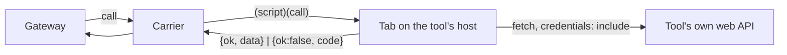

# Writing a pack

A pack is one directory: `pack.json` plus one script. The script is a single function, and the
carrier evaluates it in a signed-in tab of the tool. `packs/example/` is a worked pack for Jira
`work`. Copy it.


*The script runs as the page and uses the tab's own session. It never returns a token.*

## pack.json

```json
{
  "name": "example",
  "zone": "UTC",
  "script": "example.js",
  "tabs": { "jira": { "match": "^https://[a-z0-9-]+\\.atlassian\\.net/", "open": "https://your-site.atlassian.net/jira/your-work" } },
  "concepts": { "work": { "tab": "jira", "interval": 30, "cap": 100 } },
  "actions": { "work.comment": { "tab": "jira", "concept": "work" } }
}
```

| Field | Meaning |
|---|---|
| `tabs.<name>.match` | Regex over the tab URL. The carrier runs the script only in a matching tab |
| `tabs.<name>.open` | Where to open the tab when no tab matches |
| `concepts.<c>.interval` | Seconds between reads |
| `concepts.<c>.cap` | Max items kept |
| `actions.<a>.concept` | Which concept to re-read after the act |
| `concepts.<c>.scope`, `actions.<a>.scope` | Optional. The item field, or the act's arg, that names a target the workspace must list (see Scope) |
| `concepts.<c>.files` | Optional. `true` when the pack answers the `file` verb for this concept |

### Scope

A pack that reaches the person's own chats or channels, where the workspace may use only some of them, is
scoped. `concepts.<c>.scope` names the item field that holds the target's id (usually `id`), and
`actions.<a>.scope` names the arg that holds it (for example `chat`). The workspace's `grants.json` lists the
allowed ids under `scopes.<pack>`; a scoped pack with none listed serves nothing.

The console enforces the list, not the pack: a read keeps only listed items (before the bus sees them), a get
or an act on another id answers `out_of_scope` without running the script. The script gets the list as
`call.scope` on every scoped call, reads only those targets, and refuses any other id itself, as a second check.

### Catalog fields

Settings lists every pack a workspace can turn on. These optional fields say what it shows; none changes how
the script runs (`checkPack`, `console/server/bridge/packs.ts`).

| Field | Meaning |
|---|---|
| `kind` | `browser` (default: a tab on this PC), `remote-browser` (a tab on a work machine) or `mcp` (an MCP server). `token` is refused for now |
| `title` | The name Settings shows. A non-empty string |
| `about` | What the pack gives: one line, at most 200 characters |
| `guide` | A `.md` file next to `pack.json`, at most 2000 characters. Every run of a workspace where the pack is on reads it, under `## Sources` after the pack's title, concepts, state, scopes and acts |
| `scopeAbout` | What a scope id is and where to find it. Settings shows it as the hint for typing ids |
| `catalog: false` | Keeps the pack out of the Settings list. It still loads when a workspace grants it (`packs/example/` does this) |

A pack without a `title` shows under its name.

### Config and hosts

A pack that serves more than one workplace names no organisation, project or site. It declares the
settings it takes, and the workspace supplies the values.

```json
"config": {
  "org": { "about": "the organisation in the tool's URLs", "required": true, "pattern": "^[A-Za-z0-9-]+$" },
  "done": { "about": "states that count as closed", "list": true, "default": ["Done"] }
},
"hosts": ["tracker.example", "api.tracker.example"],
"tabs": { "site": { "match": "^https://tracker\\.example/{org}(/|$)", "open": "https://tracker.example/{org}" } }
```

| Field | Meaning |
|---|---|
| `config.<key>` | `about`, plus optional `required`, `default`, `pattern`, `enum`, and `list` for a list of strings |
| `hosts` | Every host the script may call. The tab's host is not added for you |
| `{key}` | A setting put into `tabs.*.match` (regex-escaped), `tabs.*.open` (URL-encoded) or `hosts` (as is, and the result must be a bare host name). A list key cannot be a template |

The console checks the workspace's values with `packConfig` and renders the templates with
`renderPack` (`console/server/bridge/packs.ts`). The script gets the values, defaults applied, as
`call.config`. It checks them again, because it runs on its own in the tab: a missing or malformed
value answers `bad_args` naming `config.<key>`, before any request.

Hosts follow from the pack, so turning it on grants them: a core pack's come with it, and for a workspace pack
Settings writes them into `grants.hosts` and takes them out again with the pack unless another one names them.

## The call

```js
async function (call, env) { ... }   // env is injected only by tests
```

| `call.verb` | Also has | Return `data` |
|---|---|---|
| `read` | `concept`, `watch`, `zone`, `now` | an array of items (`<concept>.item` schema) |
| `get` | `concept`, `id` | one detail (`<concept>.get` schema) |
| `file` | `concept`, `id`, `file` | `{name, mime, size, base64}` of one file the item carries, at most 20 MB |
| `act` | `action`, `args` | the act's result, small |

A scoped concept or action's call also has `scope`, the allowed ids.

Only a concept with `files: true` gets `file` calls. The console waits up to 120 s for one, and a run saves the result as an artifact with `save_source_file`. A download that comes back shorter than the declared `size` is a `source_error`, never a part of the file.

`watch` maps a concept to the ids that jobs follow. A read includes them even when they don't
match the pack's default query. A get-only concept, such as `image`, answers a read with `[]`.

### The `candidates` verb

A scoped pack may answer one more verb, `candidates`, so Settings can offer a checklist instead of typed ids.

| `call.verb` | Also has | Return `data` |
|---|---|---|
| `candidates` | nothing: no `scope`, no `concept` | `{id, name}[]` of everything the account could scope |

Only Settings calls it, when the person presses "Pick from the account"; a run never does, and `## Sources`
never lists candidates. The console keeps the first 500. A pack with no such verb answers `bad_args` (an
`unknown …` or `no verb …` message): that means it has none, and Settings tells the person to type the ids.

## Errors

Return `{ok:false, code, message, retryAfter?}` and never throw out of the function.

| Code | When |
|---|---|
| `blank` | The tab has not rendered yet |
| `unauthorized` | 401 or 403, a sign-in host, or an HTML page where JSON was expected |
| `rate_limited` | 429, with `retryAfter` in seconds |
| `not_found` | 404 |
| `too_large` | A file over the 20 MB limit. Check the size before downloading |
| `bad_args` | An unknown verb or concept, or invalid args. Check before any request |
| `source_error` | Anything else that surely did not change the source |
| `unknown` | Something failed after a write went out, so the outcome is unknown |

## Rules

- Check the tab's host for every concept and action, so the script never acts on a sign-in page.
- Validate every id against a strict regex before it reaches a URL or a query (`KEY` in the example).
- A tab whose API wants a bearer token keeps one from its own sign-in library, such as MSAL's entries in
  `localStorage`. Use the live one that expires last, only in a header from inside the tab, only to a
  declared host, and never follow a link the source returned to another host (`packs/m365-mail/`).
- Scrub tokens from every message (`scrub`).
- Return times as ISO UTC. The `zone` field is for display only.
- Keep the script self-contained, with no imports. The carrier serializes it.

## Tests

`packs/example/test/` runs the script in Node against a fake tab:

- `harness.mjs` provides a routed `fetch` that records each request, plus `location` and `document`.
  For a pack that uses the tab's MSAL tokens it also fakes `localStorage` (`msalToken`, `msalAccount`).
  `load(url)` loads any pack's script, and `run(call, {pack})` runs it.
- `validate.mjs` is a small JSON-schema check against `schemas/`.
- `contract.mjs` runs the contract over a pack's `pack.json` with your fixtures. It checks that
  reads and gets match the schemas within the cap, that an act without args is refused before any
  request, that a blank tab, a sign-in page and a missing required setting are refused, that every
  request goes to a declared host, and that no token appears in any result.

```bash
node --test "packs/**/test/*.test.mjs"
```

Each concept needs at least these tests: one item passes the schema, the watched ids are honored,
injection is dropped, and an error envelope is covered.
